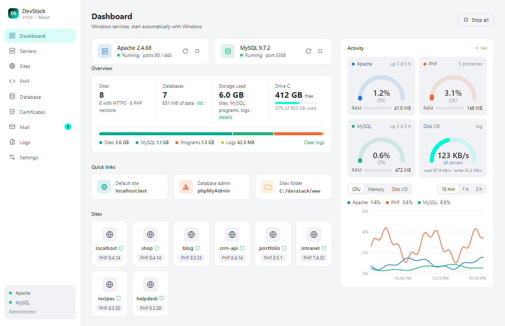
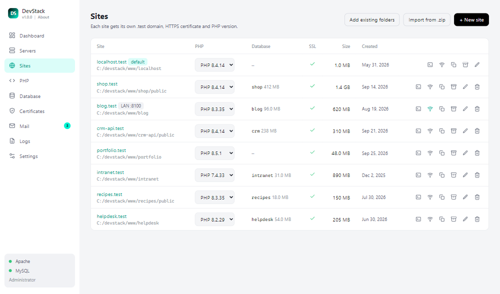
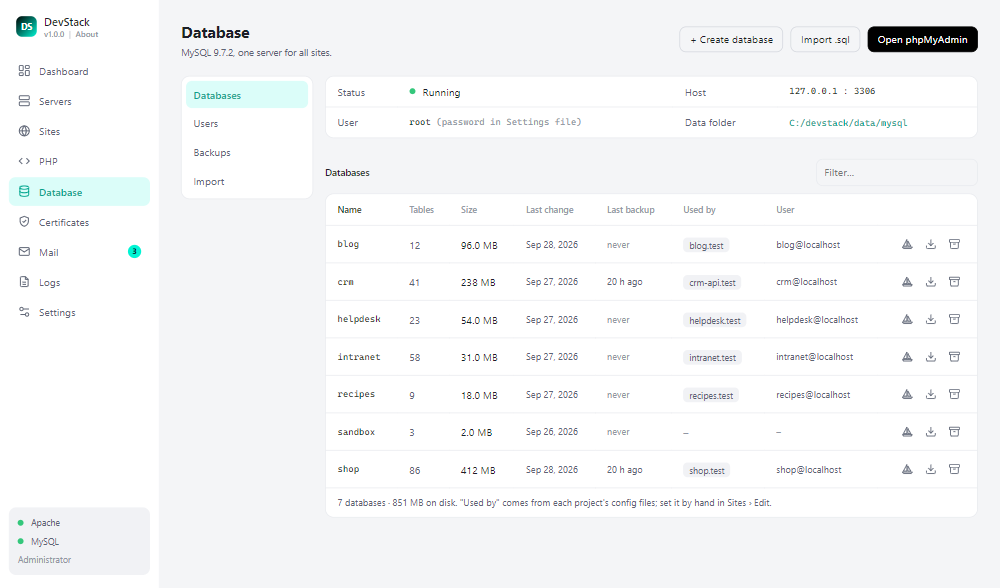
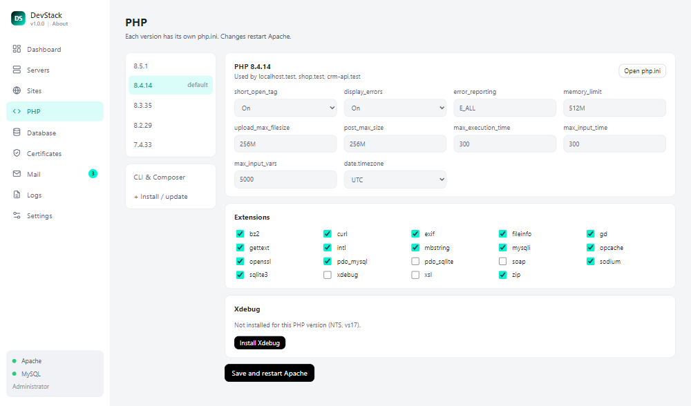
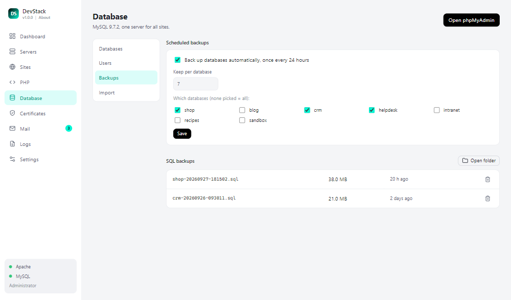
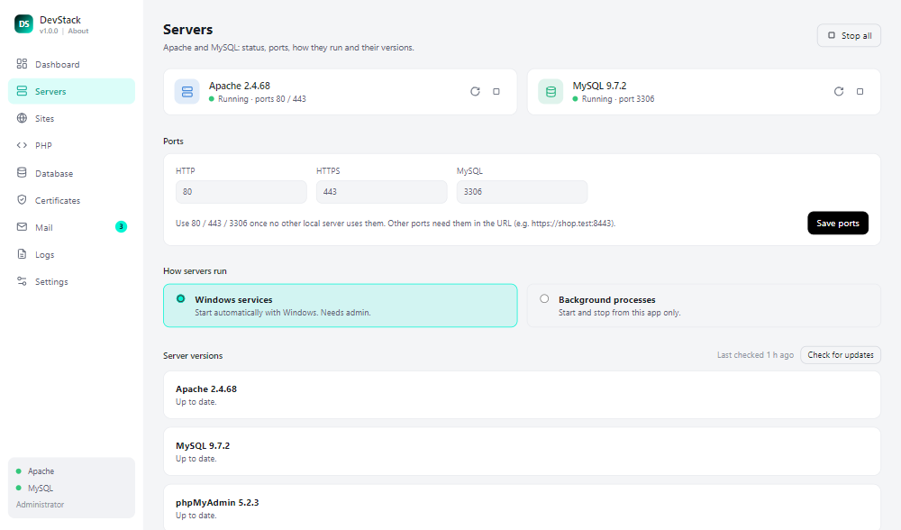
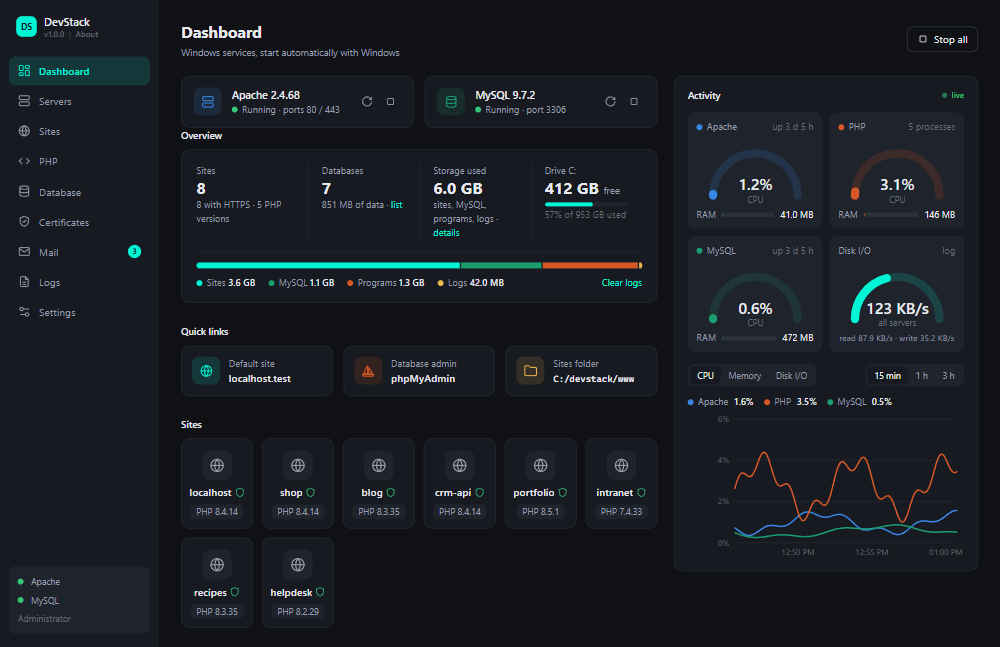

# DevStack

A local **LAMP stack for Windows**, built for PHP developers: Apache 2.4, PHP (5.6 up to the newest, a different version per site), MySQL and phpMyAdmin, with `.test` domains and trusted local HTTPS, all run from one small desktop app.



- [Features](#features)
- [Install](#install)
- [First start](#first-start)
- [Everyday use](#everyday-use)
- [Moving databases in from another local server](#moving-databases-in-from-another-local-server)
- [Command-line options](#command-line-options)
- [How it works](#how-it-works)

## Features

**Sites**
- One click creates `https://<name>.test`, with its own PHP version, HTTPS certificate and hosts entry. No vhost editing, no restart.
- Add existing project folders in bulk; `public/` or `web/` is picked as the document root automatically (Laravel, Symfony, ...).
- Per-site PHP version, aliases (`admin.shop.test`, `*.shop.test`), extra Apache directives and its own PHP error log.
- Clone a site (folder + database), export it to a .zip, import it on another machine.
- Share a site on your LAN (its own port and a QR code for phones and tablets). Off by default.
- "Terminal here" opens a console in the project folder with that site's PHP on the PATH.

**PHP**
- Install and update any PHP version from 5.6 up to the newest release (and pre-releases) from inside the app.
- php.ini editor per version: common settings, timezone, extensions. `short_open_tag` On, sane limits, OPcache tuned.
- One-click Xdebug and Composer. `php` and `composer` on the PATH, following a project's `.php-version` file.

**Database**
- MySQL (latest LTS) with phpMyAdmin at `https://localhost.test/phpmyadmin`.
- Create databases (and a user with a random password), export / import .sql files, see which site uses which database.
- Backups: one-click backup per database, plus scheduled daily backups that keep the last N copies.
- Import: bring databases in from any other MySQL or MariaDB server (see the guide below).

**App**
- Apache and MySQL run as Windows services that start with Windows, or only while you start them from the app.
- Dashboard with live CPU / RAM / disk activity, a tray icon, logs, and a Troubleshoot page that checks the setup and fixes what it safely can.
- Local mail catcher: PHP `mail()` can land in a Mail page instead of being sent. Off by default.
- Dark and light themes.

### Screenshots

<table>
  <tr>
    <td><br><sub><b>Sites</b>: PHP version, database and tools per site</sub></td>
    <td><br><sub><b>Database</b>: sizes, last backup, which site uses it</sub></td>
  </tr>
  <tr>
    <td><br><sub><b>PHP</b>: php.ini settings and extensions per version</sub></td>
    <td><br><sub><b>Backups</b>: scheduled daily backups</sub></td>
  </tr>
  <tr>
    <td><br><sub><b>Servers</b>: ports, run mode, one-click updates</sub></td>
    <td><br><sub><b>Dark theme</b></sub></td>
  </tr>
</table>

<sub>Screenshots use example data.</sub>

## Install

You need **Windows 10 or 11 (64-bit)** and **Python 3.10 or newer**.

**1. Install Python** (skip if you have it). In a terminal:

```
winget install Python.Python.3.13
```

or download it from [python.org](https://www.python.org/downloads/) and tick **Add python.exe to PATH** in the installer. Open a new terminal afterwards.

**2. Get DevStack and run the installer.** Pick a folder with a few GB free, e.g. `C:\devstack`:

```
git clone https://github.com/sillverpro/vayoweb-app-winlampds.git C:\devstack
C:\devstack\install.bat
```

No git? Download the ZIP from GitHub (Code › Download ZIP), unzip it to `C:\devstack` and double-click `install.bat`.

`install.bat` installs the Python packages, downloads Apache, PHP 8.3 + the newest PHP, MySQL and phpMyAdmin (about 450 MB, a few minutes), writes the config, and puts a **DevStack** shortcut on your desktop. If the Microsoft Visual C++ runtime is missing, it installs that too (accept the Windows prompt). Nothing outside the DevStack folder is changed until you press **Finish setup** in the app.

If something fails (e.g. a download times out), just run `install.bat` again: finished steps are skipped.

## First start

1. **Open DevStack** from the desktop shortcut (or `DevStack.bat`). Accept the Windows administrator prompt: it is needed for the hosts file, the certificates and the services.
2. **Finish setup.** The Dashboard shows a *Finish setup* banner. Press it once. It:
   - trusts DevStack's local certificate authority, so browsers show `https://*.test` as secure,
   - adds the `.test` domains to the Windows hosts file,
   - installs Apache and MySQL as Windows services (they then start with Windows).
3. **Start the servers.** Press **Start all** on the Dashboard.
4. **Open** [https://localhost.test](https://localhost.test). You should see the DevStack dashboard page.
5. **Open phpMyAdmin**: [https://localhost.test/phpmyadmin](https://localhost.test/phpmyadmin), or Database › Open phpMyAdmin.

   | | |
   |---|---|
   | Username | `root` |
   | Password | *(empty)* |
   | Host / port for your apps | `127.0.0.1` / `3306` |

   The root account has no password at first. To set one, go to **Database › Users**, click the edit icon on `root` and enter a new password; DevStack remembers it for its own tools (backups, phpMyAdmin setup).
6. **Create your first site.** Sites › **+ New site**: type a name (e.g. `shop`), pick a PHP version, optionally tick *Create a database and user*. The site is live at `https://shop.test` right away; its folder is `www/shop`. Already have projects? Use **Sites › Add existing folders** and point it at the folder that holds them.

**Ports 80 / 443 / 3306 already taken?** Another local server is probably running. Stop it (and set its services to Manual in `services.msc`), or give DevStack other ports in **Servers › Ports** (sites then need the port in the URL, e.g. `https://shop.test:8443`).

## Everyday use

| To... | Go to |
|---|---|
| Start / stop / restart Apache and MySQL | Dashboard (**Start all** / **Stop all**), the Servers page (per server), or the tray icon menu |
| Start with Windows or only on demand | Servers › How servers run: *Windows services* or *Background processes* |
| Change a site's PHP version | Sites: pick it in the row's PHP dropdown |
| Install another PHP version | PHP › Install / update |
| Edit php.ini (limits, extensions, Xdebug) | PHP › select a version |
| Update Apache, MySQL or phpMyAdmin | Servers › Server versions › Check for updates |
| See errors | Logs (Apache, MySQL, PHP, and each site's own PHP log) |
| Something wrong | Settings › Troubleshoot › Run checks |

Closing the window keeps DevStack in the tray; the servers keep running either way. Use the tray menu › **Quit DevStack** to close the app.

**Speed tip:** Windows Defender scans every PHP file on every include. Excluding the DevStack folder often makes pages much faster. In an admin PowerShell:

```powershell
Add-MpPreference -ExclusionPath "C:\devstack"
Add-MpPreference -ExclusionProcess "php-cgi.exe", "httpd.exe", "mysqld.exe"
```

Add your projects folder too if it is outside the DevStack folder.

## Moving databases in from another local server

Everything is in the app under **Database › Import**, including where other servers usually keep their data.

**Recommended: a .sql file** (works from any MySQL or MariaDB, any version)

1. In the old server's phpMyAdmin: select the database › **Export** › Quick, format SQL › **Go**.
   Or in a terminal: `mysqldump -u root -p --databases mydb > mydb.sql`
2. In DevStack: **Database › Import › Import .sql**, type the database name, keep *Create the database if it doesn't exist* ticked, pick the file (`.sql` or `.sql.gz`).
3. Point the project's config at DevStack: host `127.0.0.1`, port `3306`, user `root` (or a user you create under Database › Users).

**Everything at once: the data folder** (all databases *and* users; MySQL only, not MariaDB)

1. Stop the old server's MySQL completely.
2. **Database › Import › Import Database**: browse to its MySQL `data` folder and press **Import**.
3. DevStack keeps its own previous data as a backup folder (listed under Database › Backups), so you can go back.

The old MySQL must be the same or an older release of the same series as DevStack's MySQL (shown on the Database page). If it isn't, or if it is MariaDB, use .sql files instead.

## Command-line options

`install.bat` passes its options on to `app\bootstrap.py`:

```
install.bat --php 8.1,8.2,8.3,latest        # which PHP branches to download (default: 8.3,latest)
install.bat --ports 8080,8443,3307          # http,https,mysql - to run next to another local server
install.bat --mode process                  # servers run only while started from the app (no Windows services)
```

Starting the app: `DevStack.bat [--no-admin] [--debug]`.

## How it works

```
DevStack.bat / install.bat   start the app / first-time install
app/                         the app (Python + a WebView2 window, vanilla JS UI)
bin/apache|php|mysql         server binaries, one folder per version
apps/phpmyadmin
config/devstack.json         sites, ports, run mode   <- source of truth
config/apache/               generated httpd.conf + one file per site
data/mysql/                  MySQL databases;  data/exports/ = .sql backups
ssl/                         local certificate authority + per-site certificates
www/                         sites (www/localhost = the localhost.test dashboard)
logs/                        Apache, MySQL, PHP and per-site logs
```

- Every site is an Apache virtual host that runs PHP through **mod_fcgid** with that version's `php-cgi.exe`, so each site can use any installed PHP version and switching takes a few seconds.
- Each PHP version has its own `php.ini`; the app edits it in place and keeps your manual edits.
- HTTPS certificates come from a local certificate authority (`ssl/ca`) that Finish setup adds to Windows' trusted roots. Its private key never leaves your machine; never share or commit the `ssl/` folder.
- `.test` domains live in a marked block of the Windows hosts file.
- The app's own code is the only thing in git. Binaries, config, databases, certificates and sites (`bin/`, `apps/`, `config/`, `data/`, `ssl/`, `www/`) stay local. To move to a new PC: install DevStack there, export databases (Database › Export) and import them, and re-add your project folders with Sites › Add existing folders.
- After cloning on a machine where you'll edit the code, run `git config core.autocrlf input` (line endings are pinned in `.gitattributes`).

## License

MIT, see [LICENSE](LICENSE).
